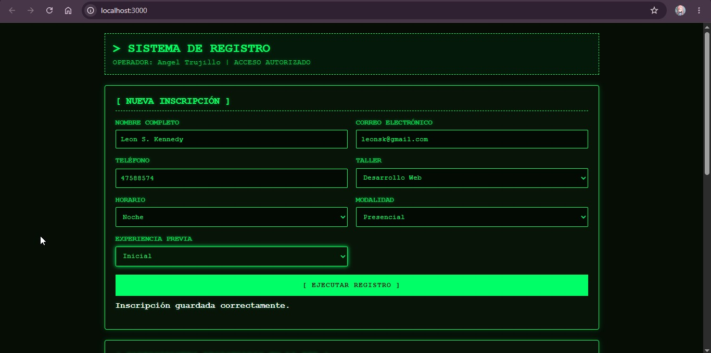
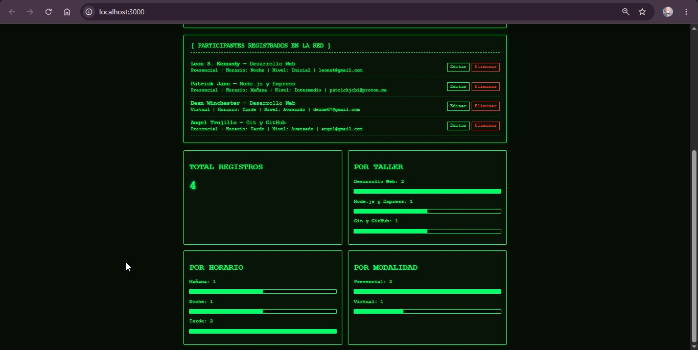

# Registro de Participantes para Taller

Sistema web interactivo para la gestión, registro y reporte visual de inscripciones a talleres técnicos. Proyecto desarrollado con Node.js, Express y SQLite, con una interfaz temática retro inspirada en PIP-OS y las terminales de Linux.

---

## Descripción del Proyecto

PIP-OS v3.0 es una aplicación web que permite administrar participantes inscritos en talleres técnicos mediante operaciones CRUD (Crear, Leer, Actualizar y Eliminar), conectadas a una base de datos persistente SQLite.

Además, incorpora un módulo de reportes que calcula y presenta estadísticas visuales en tiempo real según los registros almacenados.

### Información general

- **Nombre del proyecto:** PIP-OS v3.0 — Registro de Participantes para Taller.
- **Desarrollado por:** Angel Trujillo.
- **Tecnologías principales:** Node.js, Express y SQLite.
- **Interfaz:** HTML5, CSS3 y JavaScript.
- **Comunicación:** API REST mediante Fetch API.
- **Base de datos:** SQLite.

---

## Funcionalidades principales

- Registro de nuevos participantes.
- Visualización de participantes inscritos.
- Actualización de información de las inscripciones.
- Eliminación de registros.
- Almacenamiento persistente mediante SQLite.
- Consulta de estadísticas generales.
- Reportes agrupados por taller, horario y modalidad.
- Interfaz temática retro inspirada en PIP-OS.
- Diseño adaptable a diferentes tamaños de pantalla.

---

## Estructura del Proyecto

```text
registro-taller-angel/
│
├── capturas/
│   ├── formulario-participantes.jpeg
│   └── reportes-estadisticas.jpeg
│
├── public/
│   ├── index.html       # Interfaz gráfica del sistema
│   ├── styles.css       # Estilos visuales y diseño responsive
│   └── app.js           # Lógica del cliente y consumo de la API
│
├── database.js          # Conexión e inicialización de SQLite
├── server.js            # Servidor Express y endpoints REST
├── package.json         # Dependencias y scripts del proyecto
├── .gitignore           # Archivos excluidos del control de versiones
└── README.md            # Documentación del proyecto
```

---

## Tecnologías utilizadas

| Tecnología | Función |
|---|---|
| Node.js | Entorno de ejecución del servidor. |
| Express | Creación del servidor y API REST. |
| SQLite | Gestión y almacenamiento de datos. |
| sqlite3 | Conexión entre Node.js y SQLite. |
| HTML5 | Estructura de la interfaz. |
| CSS3 | Diseño y estilos visuales. |
| JavaScript | Funcionalidad e interactividad. |
| Fetch API | Comunicación entre el cliente y el servidor. |

---

## Endpoints de la API REST

La aplicación dispone de los siguientes endpoints para administrar las inscripciones:

| Método HTTP | Ruta | Descripción |
|---|---|---|
| GET | `/api/inscripciones` | Obtiene todas las inscripciones ordenadas por fecha reciente. |
| POST | `/api/inscripciones` | Valida y registra una nueva inscripción. |
| PUT | `/api/inscripciones/:id` | Actualiza los datos de una inscripción mediante su ID. |
| DELETE | `/api/inscripciones/:id` | Elimina una inscripción de la base de datos. |
| GET | `/api/reportes/resumen` | Obtiene el total de inscritos y estadísticas agrupadas por taller, horario y modalidad. |

---

## Base de Datos

El proyecto utiliza SQLite para almacenar permanentemente la información de los participantes.

La conexión y configuración de la base de datos se encuentran en el archivo `database.js`.

Los registros se administran desde el servidor mediante consultas SQL ejecutadas a través del paquete `sqlite3`.

---

## Instalación y Ejecución

Para ejecutar el proyecto en un entorno local, sigue estos pasos:

### 1. Requisitos previos

Es necesario tener instalado:

- [Node.js](https://nodejs.org/)
- npm (incluido con Node.js).
- Git (opcional, para clonar el repositorio).

### 2. Clonar el repositorio

```bash
git clone https://github.com/TU-USUARIO/TU-REPOSITORIO.git
```

Ingresar a la carpeta del proyecto:

```bash
cd registro-taller-angel
```

### 3. Instalar las dependencias

Ejecutar el siguiente comando en la terminal:

```bash
npm install
```

### 4. Iniciar el servidor

```bash
npm start
```

### 5. Acceder a la aplicación

Una vez iniciado el servidor, abrir el navegador y visitar:

```text
http://localhost:3000
```

La aplicación estará disponible para realizar registros, administrar participantes y consultar los reportes.

---

## Capturas de Funcionamiento

A continuación, se presentan algunas capturas de pantalla que muestran el funcionamiento y la interfaz del sistema.

### 1. Formulario de Inscripción y Lista de Participantes

En esta sección se muestra el formulario utilizado para registrar nuevos participantes, así como la lista de inscripciones almacenadas en el sistema.



### 2. Reportes Visuales y Estadísticas

Esta sección presenta los reportes generados a partir de la información almacenada en la base de datos, incluyendo el total de participantes y las estadísticas agrupadas por taller, horario y modalidad.



---

## Autor

**Angel Trujillo**

Proyecto desarrollado con fines académicos para demostrar la implementación de una aplicación web con operaciones CRUD, conexión a base de datos SQLite, API REST y generación de reportes estadísticos.

---

## Licencia

Proyecto desarrollado con fines educativos y académicos.
